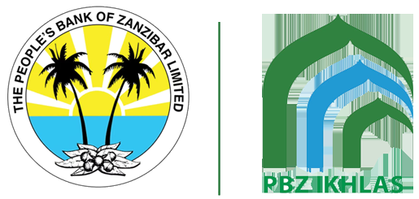

# People's Bank of Zanzibar (PBZ) &mdash; Learning Management System (PBZ LMS)

<p align="center">
  
</p>

<p align="center">
  <a href="#"></a>
  <a href="#"></a>
  <a href="#"></a>
  <a href="#"></a>
  <a href="#"></a>
</p>

---

## 🏛️ Executive Overview

The **People's Bank of Zanzibar (PBZ) Learning Management System (PBZ LMS)** is an enterprise-grade digital academy engineered specifically for PBZ staff, branch officers, compliance personnel, and external financial practitioners.

The platform provides a centralized, secure environment for:
* **Statutory Compliance Training:** Mandatory Bank of Tanzania (BOT) certifications in AML/CFT, Cyber Threat Defense, and Consumer Protection.
* **PBZ Amana Islamic Banking:** Comprehensive Shariah-compliant financing, Murabaha, and deposit management curricula alongside conventional banking tracks.
* **Continuing Professional Development (CPD):** Structured career progression pathways for branch managers, credit analysts, treasury operators, and frontline tellers.
* **Institutional Governance:** Complete branch oversight matrix indexing all branches across Unguja, Pemba, and Mainland Tanzania.

---

## 🌟 Core Pillars & Capabilities

### 1. Bank of Tanzania (BOT) Compliance Engine & Branch Matrix
* **Statutory Mandate Tracking:** Real-time compliance health scorecards and statutory filing readiness across core banking regulations.
* **Branch Oversight Matrix (`/admin/compliance/branch-matrix`):** Institutional console mapping employee certification completion percentages across branches in Unguja (Forodhani, Mwanakwerekwe, Malindi), Pemba (Chake Chake, Wete), and Mainland Tanzania (Kariakoo, Victoria).
* **Branch Escalation Workflows:** Automated escalation alerts, audit-trail logging, deadline extension governance, and mandate revocations.

### 2. Specialized Banking Curricula & Amana Islamic Banking
* **Amana Islamic Banking Academy:** Specialized modules covering Islamic jurisprudence (Fiqh al-Mu'amalat), Murabaha, Ijara, and Mudaraba financing.
* **Retail & Corporate Banking:** Frontline KYC onboarding, teller operational hygiene, credit risk appraisal, and treasury trade finance.
* **Modern Pedagogical Banking Tools:** Embedded interactive financial charting (amortization, risk breakdowns), formula rendering, and banking case-study assignments.

### 3. Drag-and-Drop Certificate Designer & QR Verification
* **Visual Canvas (`/admin/certificates/templates/builder`):** Millimeter-precise A4 landscape layout builder (1123 &times; 794 px) with live coordinate calculation and custom guilloche watermark background support.
* **Dynamic Token Substitution:** Automated placeholders for `{student_name}`, `{course_title}`, `{instructor_name}`, `{completion_date}`, `{certificate_id}`, and `{platform_name}`.
* **Public Credential Verification (`/verify-certificate`):** Cryptographic verification ID and scannable QR code embedded on every generated vector PDF for instant regulatory and employer audits.

### 4. Financial Clearance & Multi-Gateway Processing
* **Offline Bank Transfer Clearance Queue:** Administrative portal to inspect payment slips, verify bank transaction references, and activate course enrollments upon clearance.
* **Multi-Gateway Ledger:** Transaction monitoring across integrated payment gateways (Stripe, PayPal, Paystack, Flutterwave, and offline channels).

### 5. Granular RBAC & Defensive Governance
* **Capability-Based Permissions:** Governed by fine-grained permissions (`student:create`, `student:update`, `student:delete`, `instructor:create`, `instructor:update`, `instructor:delete`) decoupled from hardcoded role strings.
* **Self-Deletion Attack Mitigation:** Built-in Gate interceptors strictly prevent administrators from accidentally deleting their own active profile.
* **Course Dependency Integrity:** Safeguards prevent removing instructors with active enrolled courses.
* **Administrative Impersonation:** Secure "Login As" capability to troubleshoot branch officer workflows.

---

## 👥 Institutional Demo Accounts

| Role | Name | Email | Password | Scope & Department |
| :--- | :--- | :--- | :--- | :--- |
| **Executive Admin** | PBZ Executive Administrator | `admin@pbzbank.co.tz` | `password123` | System-wide Governance & Compliance Control |
| **Faculty / Instructor** | Dr. Amina Khamis Salim | `compliance@pbzbank.co.tz` | `password123` | Head of AML & Regulatory Compliance Faculty |
| **Branch Manager** | Fadhila Abdalla Haji | `manager.forodhani@pbzbank.co.tz` | `password123` | Forodhani Main Branch Operations Manager |
| **Senior Teller / Trainee** | Renatus Bernardo | `renatus.bernardo@pbzbank.co.tz` | `password123` | Retail & Frontline KYC Operations |

*(Standard fallback demo accounts `admin@eduex.com` / `password`, `instructor@eduex.com` / `password`, and `student@eduex.com` / `password` are also retained for legacy testing).*

---

## 🛠️ Technology Stack

* **Framework:** [Laravel 12.x](https://laravel.com) on **PHP 8.3+**
* **Database:** MySQL / MariaDB (SQLite supported for in-memory automated testing)
* **Design System:** PBZ Corporate Palette (Deep Navy `#0a2540`, Amber Gold `#f59e0b`, Emerald, and Slate) with responsive Blade views and Vanilla CSS/TailwindCSS utility tokens
* **PDF & Media Processing:** DomPDF vector generation engine for certificates, transcripts, and event tickets
* **Frontend Tooling:** Vite, Node 20, modern ES modules
* **Authentication & RBAC:** Multi-guard sessions with Spatie Laravel-Permission & custom Gate policies

---

## 🚀 Local Development Setup

### Prerequisites
* **PHP:** >= 8.3 (with `pdo`, `mbstring`, `dom`, `gd`, `zip`, `bcmath`, `curl`, `intl`)
* **Composer:** >= 2.x
* **Node.js & npm:** >= 20.x
* **Web Server:** MAMP, Apache, Nginx, or Laravel built-in CLI server

### Installation Steps

1. **Clone the Repository:**
   ```bash
   git clone https://github.com/wolinet-renatus/pbz.git
   cd pbz
   ```

2. **Install Dependencies:**
   ```bash
   composer install
   npm install
   ```

3. **Configure Environment:**
   ```bash
   cp .env.example .env
   php artisan key:generate
   ```
   *Update your database credentials (`DB_DATABASE`, `DB_USERNAME`, `DB_PASSWORD`) in `.env`.*

4. **Run Migrations & Seeders:**
   ```bash
   php artisan migrate --seed
   ```

5. **Link Storage & Build Frontend Assets:**
   ```bash
   php artisan storage:link
   npm run build
   ```

6. **Start the Development Server:**
   ```bash
   php artisan serve
   ```
   *Or access via your local MAMP host at `http://localhost/pbzlms/public`.*

---

## 🔄 CI/CD & Automation

This repository includes enterprise automated CI/CD workflows via **GitHub Actions**:

* **Continuous Integration ([`.github/workflows/ci.yml`](.github/workflows/ci.yml)):**
  * Automated testing matrix on PHP 8.3 & Node 20.
  * Dependency caching for rapid build times.
  * Asset packaging verification (`npm run build`).
  * Automated code formatting checks via **Laravel Pint**.
  * Full test suite execution via **PHPUnit**.
* **Continuous Deployment ([`.github/workflows/cd.yml`](.github/workflows/cd.yml)):**
  * Automated SSH production deployment pipeline with zero downtime (`php artisan down` / `php artisan up`).
  * Automated migrations, asset bundling, cache warming, and queue worker refreshes.
  * Optional fast-path Webhook deployment support.
  * Detailed setup instructions available in [`.github/DEPLOYMENT_GUIDE.md`](.github/DEPLOYMENT_GUIDE.md).

---

## 📜 Regulatory Notice & Compliance

This platform is engineered in strict accordance with the **Bank of Tanzania (BOT) IT Governance and Cybersecurity Guidelines**, incorporating granular audit trails, access veto protections, encrypted session boundaries, and verifiable digital certificate issuance.

&copy; People's Bank of Zanzibar (PBZ). All rights reserved.
